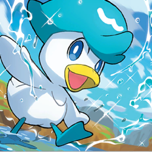
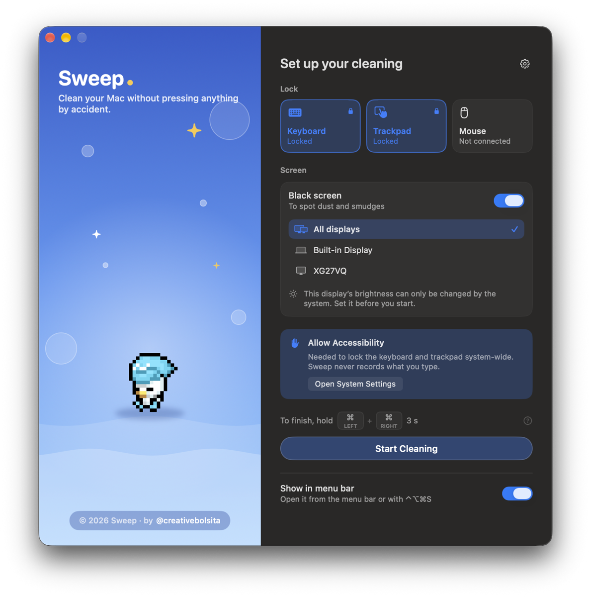

<div align="center">



# Sweep

**Clean your Mac without pressing anything by accident.**

Lock the keyboard, trackpad or mouse, turn the screen black, and wipe away.<br>
When you're done, hold both <kbd>⌘</kbd> keys for 3 seconds.

[](https://github.com/Isiguenza/Sweep/releases/latest)


[](LICENSE)



</div>

---

## Features

- **Lock the keyboard**: every key is swallowed while you clean, including the lock button.
- **Lock the trackpad and/or an external mouse**, separately.
- **Black screen** on all displays or just one, so dust and smudges stand out.
- **Brightness boost** (optional): raises the real brightness while you clean and restores it afterwards.
- **Unlock chord**: hold **left ⌘ + right ⌘** for 3 seconds. Hard to hit with a cloth, easy to do on purpose.
- **Safety net**: a cleaning ends on its own after 2–15 minutes, or when you close the lid. Input, cursor and brightness are always restored. If Sweep ever quits unexpectedly, input comes back immediately and brightness is fixed on the next launch.
- **A pixel-art mascot** that keeps you company while you clean.
- **Global shortcut** (<kbd>⌃</kbd><kbd>⌥</kbd><kbd>⌘</kbd><kbd>S</kbd> by default) and a menu bar icon. It can also launch at login.

## Install

1. Download **`Sweep-x.y.dmg`** from the [latest release](https://github.com/Isiguenza/Sweep/releases/latest).
2. Open it and drag **Sweep** into **Applications**.
3. Launch Sweep. The app is signed and notarized by Apple, so it opens like any other app.

### Permissions

| Permission | Why |
| --- | --- |
| **Accessibility** | Required to lock the keyboard and trackpad system-wide. |
| **Input Monitoring** | Optional. Only used to tell an external mouse apart from the trackpad. |

Sweep never records or sends what you type. Everything runs locally.

## Build from source

Requires **Xcode 26+** and **macOS 14+**.

```sh
git clone https://github.com/Isiguenza/Sweep.git
cd Sweep
open Sweep.xcodeproj   # then ⌘R
```

Run the tests with:

```sh
xcodebuild test -project Sweep.xcodeproj -scheme Sweep -destination 'platform=macOS'
```

### Package a DMG

```sh
./scripts/make-dmg.sh
```

This archives a Release build, signs it with the first *Developer ID Application* identity in your keychain, and builds `dist/Sweep-<version>.dmg` with a styled Finder window. Set `NOTARY_PROFILE=<profile>` to notarize and staple it as well. See the header of [`scripts/make-dmg.sh`](scripts/make-dmg.sh) for details.

## Project layout

```
Sweep/
├── App/         App controller and preferences
├── Session/     Cleaning session lifecycle, unlock detection, system services
├── Input/       Event tap blocking, permissions, pointing devices
├── Display/     Black overlays, brightness, window morphing
├── Shortcuts/   Global hotkey and recorder
└── UI/          SwiftUI views, theme and mascot
SweepTests/      Unit tests (session, unlock chord, policies, shortcuts)
scripts/         DMG packaging
```

## Contributing

Issues and pull requests are welcome. If you find a way that input slips through during a cleaning, please [open an issue](https://github.com/Isiguenza/Sweep/issues).

## License

Sweep is free software, released under the [GNU General Public License v3.0](LICENSE).

The mascot is Quaxly, a Pokémon. Pokémon and its characters are trademarks of Nintendo, Game Freak and The Pokémon Company. This is a fan project and is not affiliated with or endorsed by them.

---

<div align="center">
Made by <a href="https://x.com/creativebolsita">@creativebolsita</a>
</div>
